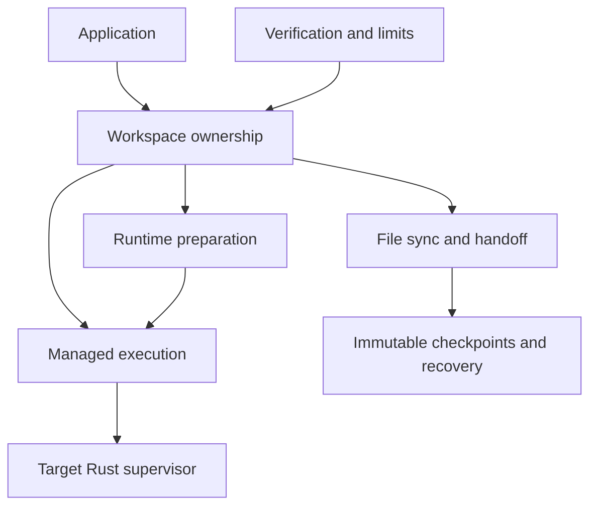

Workspace SDK lets an application open a target, run a program, reconnect after its client exits, and bring selected files home for review. Applications supply accounts, access, private state locations, supervisor binaries, and agent logic.

[Open and reconnect](workspace.md), [run and reconnect](execution.md), [review and publish files](sync.md), and [prepare a runtime](preparation.md) explain the main user goals. Each page distinguishes recorded intent, observed effects, and uncertainty.

The library supports Local, Boat, SSH, and container adapters. Local execution also ran inside a Vercel Linux VM; that evidence does not establish a Vercel provider. See [verification and limits](verification.md) before choosing deployment acceptance criteria.

Source checkpoint: inspected baseline `0b7bbc0a9be0cce0713df05be56f2a63d6c14c30`. This map describes that architecture plus the persistence hardening recorded in the readiness review. The [architecture guide](../architecture.md) owns dependency and deployment details.
