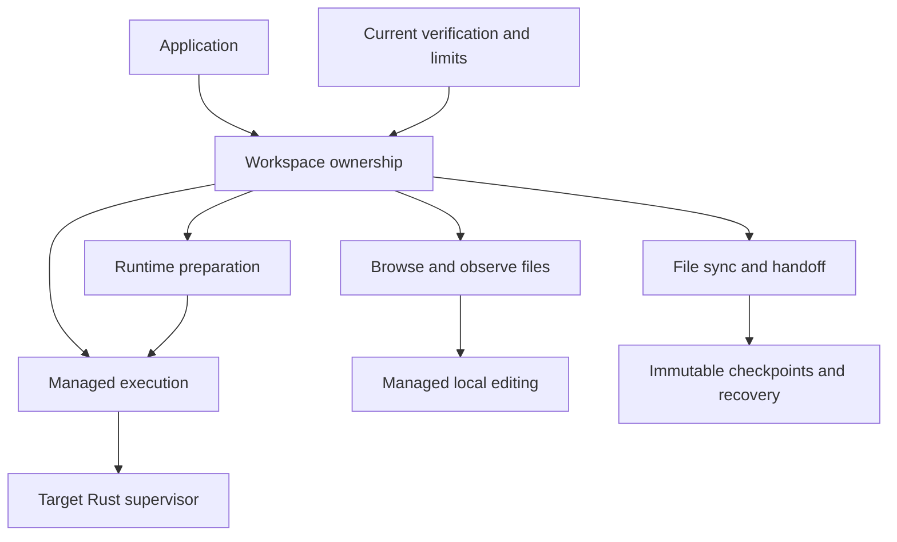

Workspace SDK lets an application open a target, run a program, reconnect after its client exits, and bring selected files home for review. Applications supply accounts, access, private state locations, supervisor binaries, and agent logic.

[Open and reconnect](workspace.md), [run and reconnect](execution.md), [review and publish files](sync.md), and [prepare a runtime](preparation.md) explain the main user goals. Each page distinguishes recorded intent, observed effects, and uncertainty.

The library supports Local, Boat, SSH, and container adapters. Local execution also ran inside a Vercel Linux VM; that evidence does not establish a Vercel provider. See [verification and limits](verification.md) before choosing deployment acceptance criteria.

Source checkpoint: inspected baseline `0b7bbc0a9be0cce0713df05be56f2a63d6c14c30`. This map describes that architecture plus the persistence hardening recorded in the readiness review. The [architecture guide](../architecture.md) owns dependency and deployment details.

[Browse and observe files](files.md) documents the qualified Linux first slice and remaining live editing work. This navigation addition does not advance unrelated pages' source checkpoints.

[Managed local editing](managed-editing.md) stages candidates and reuses checkpoint review/publication within explicit caller quiescence and shared SDK coordination.

[Feature ownership and verification map](feature-map.md) links the expanded provider, persistence, identity, handoff, observation and edit-review coverage.

## Make a safe next decision

- If opening timed out, [inspect the saved identity](open-identity.md) before deciding whether to retry creation.
- If a file poll failed halfway, [retain the last complete view](directory-baseline.md).
- If a human changed files after review, [review the current candidate again](edit-review.md) rather than apply a stale review.
- If a run is Lost, [do not hand it off as stopped](handoff.md).
- Compare [provider boundaries](providers.md) before promising isolation or deletion.
- Keep [private receipts and leases](persistence.md) outside transferred projects.

[Current verification](verification-current.md) separates checks run for this update from historical deployment evidence.
