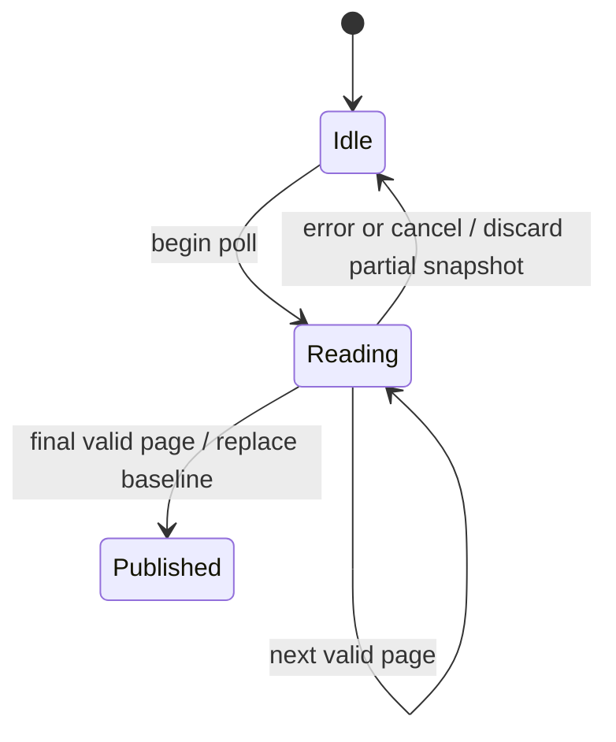

When a directory listing changes halfway through a poll, keep the previous complete view. The observer publishes a new view only after every page is valid.

## Example: the second page changed

The first page was read at revision A, then another writer changed the directory before page two. The poll returns Conflict and keeps the old complete baseline. Keep showing the old view as stale and retry a whole poll; do not merge the partial first page into it. The next successful result contains current differences, not every event that occurred between polls. Dropping the observer and constructing another deliberately yields a reset on its first successful poll.

## Progress and ownership

An observer has no background task: the caller drives polling. It gathers at most 16 pages and 4,096 immediate children, rejects duplicate paths and nonadvancing cursors, and requires one revision across the entire poll. Only after the final page does it compute upserts/removals and replace its baseline. The first success is a reset. A new observer after restart starts fresh; it cannot reconstruct transient events between polls. Rename is removal plus upsert.

## Model coverage

The model has an old baseline and a two-page candidate with independently chosen revisions. Receiving pages advances an independent count; publication records the count actually received, rather than assigning a completed count. It checks that published candidates contain both pages with one revision, and aborted polls preserve the baseline. This abstracts real validation, byte/path bounds and full directory contents. [File browsing](files.md) details revision-bound reads and Linux-only exclusive creation.
