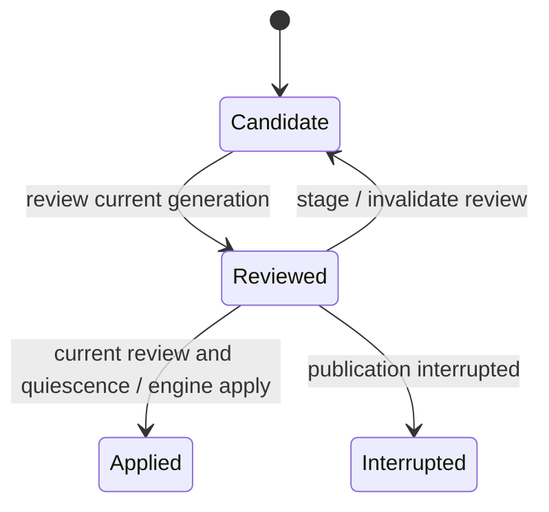

Before publishing a staged file edit, review the candidate you will actually apply. Adding another edit invalidates the old review, so it cannot authorize publication of the new candidate.

## Example: one more edit after review

A caller reviews candidate generation one, then successfully stages another change. That stage invalidates the previous review. Applying the old review must fail even if the caller still has its reference. Obtain the new revision and review again. If publication instead became Interrupted, do not stage over it: retain the review reference and use the engine's inspect/recovery path described in [managed editing](managed-editing.md#failure-and-restart). A cancelled async waiter is not proof blocking filesystem publication stopped; the host must keep its lease and writer-quiescence (all other file writers stopped) boundary until work settles.

## Progress and ownership

Session revisions bind nonce, generation and tree fingerprint. Reads, stages and review operations reject stale or foreign revisions. Successful staging clears the latest review. Apply requires the current revision, latest review reference, a cooperative lease and explicit external-writer quiescence. The engine additionally checks the destination fingerprint and unresolved conflicts. Interrupted or already-applied reviews block changing the candidate; recovery remains engine-owned. Sessions themselves are not restartable.

## Model coverage

Two generations and a retained caller review model stale publication attempts. The environment may toggle its quiescence assertion. The model checks that accepted apply uses the current reviewed generation and a true assertion. The assertion is a caller obligation, not an OS lock or proof arbitrary editors stopped. [Managed editing](managed-editing.md) owns complete budgets, conflict resolution and recovery.
