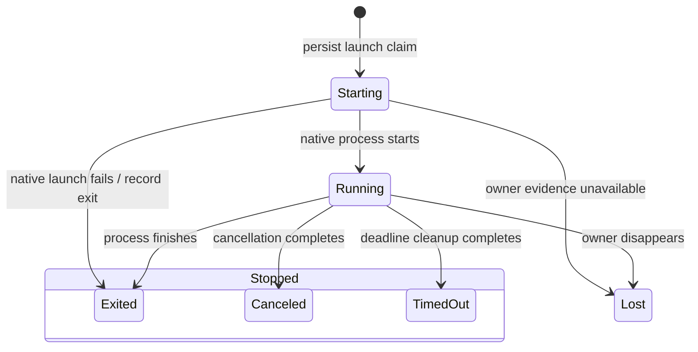

A run ID binds one command to one workspace. The target supervisor keeps its claim, output, and completion evidence after the SDK handle disappears. Repeating the same launch reconnects; changing its intent is refused.

## Reconnect and control

Client wait timeout does not cancel the target process. Retain its workspace and run references to reconnect. Output uses absolute byte cursors and bounded retention. PTY stdout and stderr share one stream. A reported gap means some bytes are unavailable; completion does not imply gap-free output.

Terminal input is transient and limited. A partial acknowledgement permits only the unsent suffix; a missing acknowledgement can mean input was delivered. Unknown delivery must not trigger automatic replay. Resize and control calls have bounded waits. See [PTY integration](../pty-integration.md) for exact budgets and transport contracts.

## Uncertain ownership

Lost means termination could not be established. It is not a stopped state and cannot authorize another writer or handoff. Retain the original launch claim and reconcile the owning target. Do not replace it merely because the client connection failed.

## Confirmed stop

Exit, completed cancellation, and deadline expiry remain distinct recorded outcomes. Cleanup must release owned descendants before completion. Handoff accepts only a confirmed terminal source. Process exit zero still does not establish successful native authentication.
