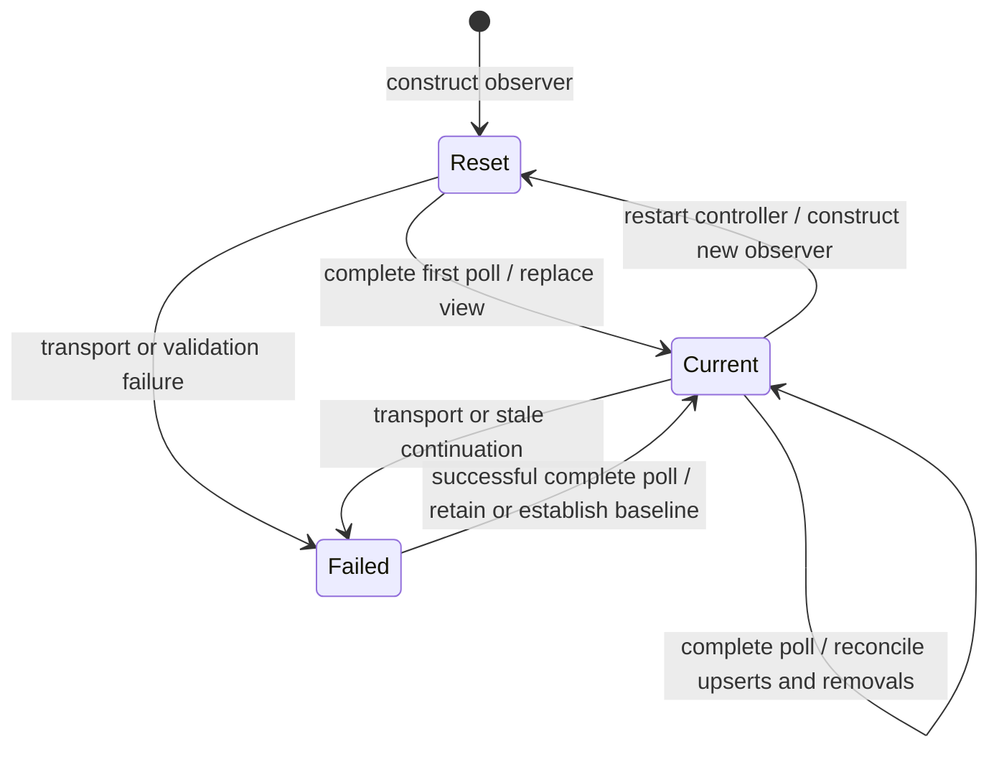
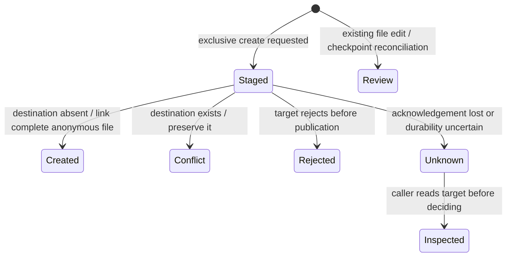

Applications can browse immediate children, read binary chunks, and poll for changes made by a human, agent, or external tool. The application owns its UI and timer. This first slice creates a complete new file only when the destination is absent. It does not finish the broader human and agent collaborative editing request in [issue 4](https://github.com/nessalabs/workspace-sdk/issues/4).

## Reset and reconnect

The first successful poll returns a reset. Discard the prior directory view and use its entries. Baselines live only in the observer; no event journal or cursor needs to survive restart. Reconnect to the workspace and construct a new observer for a fresh baseline. Dropping it releases metadata. It owns no background tasks, timers, sockets or watcher handles.

## Complete reconciliation

Each poll reads every page of one directory before advancing its baseline. Results contain new or modified entries and paths now absent. External rename appears as removal plus creation. Empty directories are visible. Short-lived changes between polls are not retained. Observe each expanded directory separately. This is not recursive loading, an event history or an atomic multi-file snapshot.

There is no OS watcher queue to overflow. A future push watcher must reconcile after overflow, disconnect or unknown cursors. This version always reconciles. Stale pagination rejects the poll and preserves its prior baseline.

Pages contain at most 256 entries. Native scans and observer baselines have a 4,096-entry cap; larger directories explicitly return Unsupported. The observer permits at most 16 pages. Request bounds, duplicate paths, direct-child scope, ordering, revisions and cursor progress are checked at boundaries. Names must be UTF-8 portable workspace paths of at most 4,096 bytes; an unrepresentable entry rejects the listing.

Each page rescans metadata. Three local debug-build samples over 4,096 entries took about 1.15–1.20 seconds per poll, or 16 full scans. Poll only visible directories, serialize polls and use a several-second interval with backoff. These are [local samples](../evidence/2026-10-23-workspace-files/files-performance.log), not a statistical baseline or remote latency qualification.

## Failed observations

Transport failure, disappearing entries, unsupported sizes and stale continuations leave the previous baseline intact. Retry a complete poll. Cancellation before completion also preserves that baseline. The next successful poll accounts for current differences, but cannot reconstruct transient history. The SDK installs no hidden retry loop.

## Revision reads and binary files

Versioned reads return at most 256 KiB, a next offset, EOF and a revision. Retain the first token for every following chunk. Discard the buffered content and restart on Conflict. The target checks metadata before and after reading and reopens the pathname to detect replacement. Files may exceed one chunk; no browser-managed full-file allocation occurs.

Tokens fingerprint workspace ID, root, relative path, device, inode, length, mode, mtime and ctime. Keep them on the same connected target. They are metadata observations, not immutable/content-addressed snapshots, authorization or writer locks. Detection depends on filesystem inode/timestamp semantics. Filesystems that hide changes behind identical metadata, remote filesystems and adversarial same-UID namespace manipulation are not qualified. Use immutable checkpoints for stronger snapshot semantics.

## Publication outcomes

Creation stages at most 256 KiB in an anonymous Linux file, syncs it, then exclusively links it into an existing parent. An existing file, symlink, directory or special entry produces Conflict without replacement. Concurrent SDK participants have one winner. A killed staging process leaves no named partial file. Filesystems without anonymous staging return Unsupported.

## Uncertain publication

Unknown means creation may have happened. Read/list and reconcile the destination before deciding to retry. All transport and malformed-response failures after dispatch preserve uncertainty. Only an explicit target rejection or validation before dispatch proves rejection. A parent-directory sync failure also returns Unknown. Cancellation is not rollback. Creation has no durable idempotency receipt and is never automatically replayed.

## Existing file editing

Native live revision replacement is Unsupported. Provider delete/rename mutations are not added; those external changes are observed. The separate [managed local edit session](managed-editing.md) stages create/replace/delete/rename candidates and publishes through checkpoint review at an explicit quiescent boundary. The existing low-level chunk write remains non-atomic transfer and must not be used as an editor save operation.

The existing [checkpoint workflow](sync.md) owns three-way detection, preserved base/local/remote conflict sides, explicit resolution acknowledgement, expected local fingerprints and apply recovery. Review does not mutate the destination. Apply requires every writer to stop and an explicit caller quiescence assertion. SDK leases coordinate SDK callers, not arbitrary editors. This is deliberate conflict resolution, not automatic collaborative text or CRDT merging.

The implemented [managed local editing workflow](managed-editing.md) captures a baseline, stages revision-checked candidates, reconciles current contents and accepts explicit resolutions. It reuses checkpoint publication, a root-qualified cooperative SDK lease and a caller quiescence assertion. The lease cannot fence arbitrary editors. Hash-then-replace remains insufficient for unattended live saves; an enforceable writer authority or provider-native conditional publication is still needed for that broader capability.

## Boundaries and provider qualification

Linux and macOS observations reuse no-follow descriptor traversal. Listing enumerates an owned POSIX directory stream and obtains metadata relative to its descriptor without following symlinks. Linux no-clobber publication remains descriptor-anchored. Symlinks are visible but never followed. Reads reject nonregular entries such as FIFOs and sockets. The private control root stays separate and ownership-checked. This retains the existing trusted-host permission model; it is not an isolation boundary against arbitrary programs with the same OS user.

The optional IBackend contract and wire operations are provider-neutral. Local Linux observations were exercised end to end. The same portable tests execute on macOS CI; local Linux execution alone is not macOS qualification. SSH seam regressions use synthetic responses. Boat and container have no new live qualification. They can carry these operations only with a matching deployed supervisor and supported target filesystem. Observation is implemented for Linux and macOS. Native publication remains Linux-only; other targets explicitly return Unsupported. Custom backends default to Unsupported. Existing chunk-transfer capability flags do not advertise conditional publication.

## Evidence and reviewed scope

The sourceRevision names the exact reviewed source commit, based on merged PR5 `db98741b2166e2f9f829eeac1bd64da65e033ef1`. [E2E tests](../../tests/workspace_files.rs), [transport regressions](../../tests/provider_transports.rs), [native crash cleanup](../../src/supervisor/file_browser.rs) and [existing checkpoint conflict tests](../../tests/checkpoint_engine.rs) cover different boundaries. Executed gates, review closure and rendered/drill-down validation are recorded in the [follow-up review](../reviews/2026-10-23-managed-editing.md). Initial Linux-only foundation evidence remains in the [earlier review](../reviews/2026-10-23-workspace-files.md). Tests used synthetic workspaces only. No user migration, destructive resync or secrets upload occurred.
