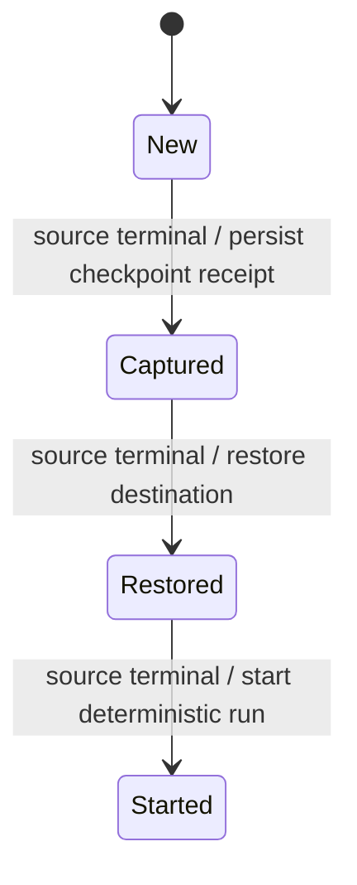

To continue a workload on another machine, first confirm that its source run has stopped. Handoff then transfers selected files and starts the continuation command you supplied.

## Example: the laptop stops hearing from the source

A disconnected client may observe Lost rather than a confirmed terminal run. It cannot use that uncertainty as permission to start the same work elsewhere. Reconnect and establish the source run's terminal state first, stop all other file writers, then hand off to a different empty target using an explicit continuation command. If the handoff caller stops awaiting after admission, the owned operation can still finish. Retain its operation ID and inspect its receipt; observer cancellation does not undo the destination launch.

## Progress and ownership

The caller must assert quiescence (all other file writers stopped), use different source and destination workspaces, and pass a run belonging to the source. The receipt binds source run, destination, command, secret environment and private input by fingerprint. Reusing an operation ID with different inputs is a conflict. The service rechecks terminal source state before capture, restore and start; Lost is not terminal. A Started receipt returns the recorded result. The destination run ID derives from operation ID, enabling supervisor duplicate-launch protection after a lost receipt save.

Files move, not VM/process memory. The caller supplies the continuation command and must put any portable agent state into allowed files. A failed handoff does not restart the source. Transfer cleanup is best effort; failure to remove transfer scratch does not become a successful cleanup claim.

## Model coverage

Four phases and source states Running, Lost and Stopped check that destination start never accepts uncertain source ownership. The source can become Lost after capture, forcing later checks to matter. Separate invariants correlate capture and restoration to a stopped source. Filesystem contents, identities, provider retries and secret handling remain outside this small model. [Sync](sync.md) owns review and publication.
