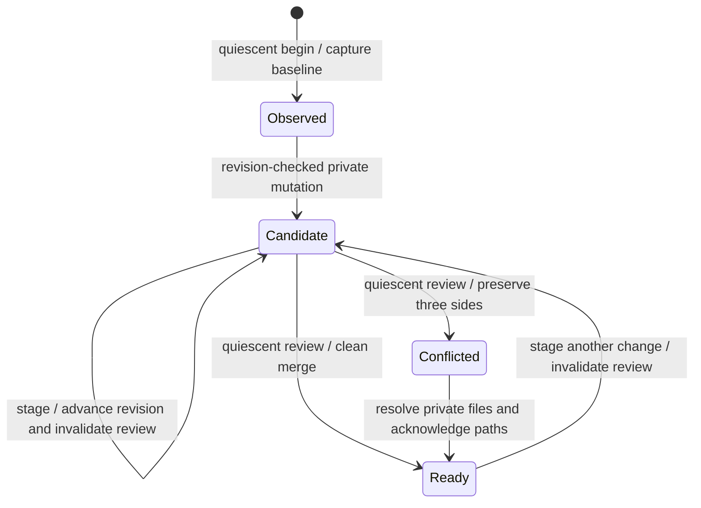
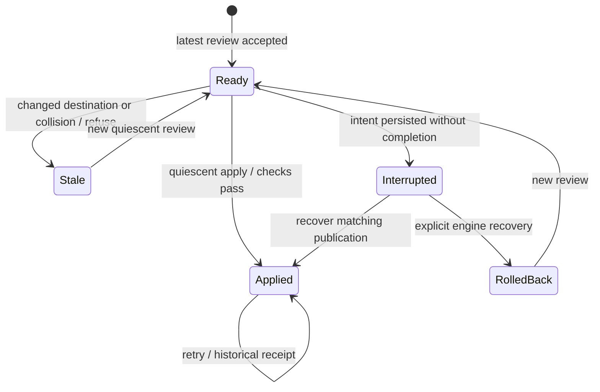

A managed session edits a private selected-tree candidate instead of writing live files on each save. Before publication, the existing checkpoint engine compares that candidate with the baseline and current local files. Human changes are preserved for review. Publication requires the application to stop unmanaged writers and explicitly assert quiescence. This supplies a useful local editing workflow on Linux and macOS, while live unattended saves against arbitrary external editors remain outside [issue 4](https://github.com/nessalabs/workspace-sdk/issues/4)'s completed scope.

Publication is a separate explicit step after review. A failure preserves its review/recovery identity rather than permitting an unrelated retry.

## Private candidates

Begin captures selected project files without modifying the project. Every session gets its own revision namespace. Reads and mutations require the current revision, so stale or cross-session requests fail even if their bytes happen to match. A successful stage returns a new revision and invalidates any previous unapplied review. Failed stages preserve candidate/review meaning.

Create requires an absent candidate entry; replace requires an existing regular file; delete removes one selected file or symlink; rename requires an absent target and moves one selected entry. Directories are inferred, not independently edited. Symlinks are never followed for candidate reads/replacement; the engine validates their complete graph when admitting the candidate. Binary create/replace and read requests are bounded to 256 KiB. Larger existing files can be read in chunks within the session's tree bound.

The candidate uses existing validated checkpoint archives. GitCheckpointEngine owns mandatory exclusions, portable paths, modes, checksums, overlap/case checks and symlink policy. There is no second merge engine or new live provider write API. Explicit candidate selection can include an ignored path, but publication refuses collisions with uncaptured live data rather than replacing it. Case-only renames on case-insensitive filesystems may be conservatively refused by collision preflight.

## Human and agent changes

A review passes baseline, current live tree and candidate checkpoint to the existing reconciliation owner. It does not mutate the destination. Nonoverlapping changes can produce a clean review; conflicts preserve exact base/local/candidate bytes. Edit the private review directory and explicitly acknowledge every conflict through the session's resolution method. A clean review still requires an explicit apply.

An application can show live [file observations](files.md) alongside a staged candidate, but their tokens serve different purposes: live tokens fingerprint filesystem metadata; edit revisions identify an immutable session candidate and its generation. They are not interchangeable. No CRDT or per-keystroke collaborative text protocol is added.

## Publication boundary

Begin, review and apply reject `quiescent=false`. The application must actually stop or pause every unmanaged editor, agent, build tool and other writer for the entire requested live-tree operation. A boolean assertion is not proof that it happened. Writers can run again between boundaries; a changed destination after review is rejected at apply by the engine's expected fingerprint.

LocalEditCoordinator records the canonical directory's device/inode, refuses replacement between operations, and holds a nonblocking workflow lease derived from the canonical root through each blocking use case. This serializes participating SDK controllers that share the same repository/root. It does not protect against arbitrary processes, other repositories, mount aliases or callers bypassing this session and using lower-level engine/file APIs. The application still owns actual writer quiescence; the SDK cannot enforce it on arbitrary external editors.

Before initial publication, the checkpoint owner now checks every result path/ancestor for uncaptured data. An existing ignored file, symlink or empty directory is a conflict. Replacing a selected directory is refused if it contains excluded or unrelated children. These checks run before recovery intent or mutation, so failure cannot trigger rollback that removes data absent from the backup. Prefix lookup reuses the selected catalogue; shared traversal bounds include metadata checks and directory visits. This is defensive preflight at the asserted boundary, not atomic compare-and-swap against concurrent OS writers.

## Bounds and scheduling

Construct the injected engine with `ManagedEditSession::checkpoint_limits()` or stricter limits. The session checks the engine's advertised effective bounds before capture: 4,096 entries, 8 MiB selected decoded bytes, 8 MiB per existing file, 32 MiB bundle and 16 MiB metadata. Those engine limits also govern live review captures, merged results, explicit resolutions and recovery. Oversized input is refused before a retained oversized checkpoint or publication.

Mutation paths/from/to are checked before archive cloning: non-root, at most 4,096 bytes. Resolution acknowledgements accept at most 4,096 paths of at most 4,096 bytes. Each session permits 32 snapshot-producing stage attempts, 16 reviews and 16 resolutions. Failures consume attempts. Separate budgets leave review/resolution capacity after the final allowed stage; advancing a candidate or opening a review is refused once completion capacity is exhausted. Attempt limits bound retained private work, not guaranteed completion after arbitrary failures.

These APIs block. Async hosts should run the entire use case on a blocking executor and keep session/lease ownership inside its closure until completion. Canceling the waiter does not cancel filesystem work or authorize retry. No background task, watch queue or automatic apply retry is installed.

Three Linux debug samples over 257 entries and at least 1 MiB took about 1.17 seconds for begin, 0.45 for a 256 KiB stage, 3.8 for review and 1.54 for apply. This is an explicit batch review/save workflow, not a per-keystroke latency claim. The samples are [recorded evidence](../evidence/2026-10-23-managed-editing/edit-performance.log), not a statistical baseline or remote/macOS performance qualification.

## Failure and restart

Inspect the engine's durable apply state after a failed or uncertain apply. Interrupted publication blocks replacement of the pending candidate or review. Existing engine recovery can complete an already published matching result or explicitly roll back. Rolled-back work needs a new review. Completed retry returns its original receipt and does not overwrite later human changes.

Session objects and their revision namespace are memory-owned and have no resume API. Persist review references/receipts externally when restart inspection is needed, reopen the same engine store and inspect its existing journals. The tests model a lost completion receipt using synthetic engine state, following the existing checkpoint fixture; this does not claim process-kill coverage for every Git operation. Starting a new session after restart establishes a fresh baseline.

## Completion and retention

After apply, the session refuses further staging; begin a new session for the next edit. Dropping a session releases its in-memory candidate. Active operation leases release on return/error or controller process death. Checkpoints, conflict originals, reviews and recovery journals remain in private engine storage for application-owned retention. Dropping the session does not delete recovery data or roll back published files. Both checkpoint storage and the lease repository must stay outside synchronized project roots and be protected as private application data.

## Qualification and remaining work

The composition uses local POSIX paths and the existing Git engine. Linux real-engine tests pass; actual macOS execution is gated by this follow-up PR's CI. macOS observation has executable portable subprocess tests, not an Unsupported-only test. Linux still owns native no-clobber creation; macOS live provider publication remains Unsupported. No remote managed-edit transport, durable session resume, push watcher/event log, automatic text collaboration or enforcement against arbitrary external writers is claimed.

The [synthetic runnable example](../../examples/managed_edit.rs), [managed-edit E2E tests](../../tests/managed_edit_sessions.rs), [portable observation tests](../../tests/workspace_files_portable.rs) and [review/evidence](../reviews/2026-10-23-managed-editing.md) show concrete boundaries. Source checkpoint above names the exact reviewed source; unrelated pages are not advanced by navigation changes.
