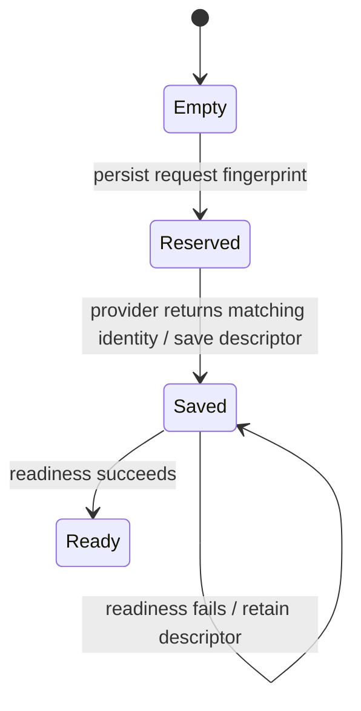

If opening a workspace times out, first determine whether the SDK already saved its target reference. A workspace ID binds one provider request; repeating that request can reconnect instead of creating another target.

## Example: readiness failed after creation

Suppose opening `build-17` returns a readiness timeout. The provider may already have created the target, and the SDK saves a valid descriptor (the saved target reference and capabilities) before checking readiness. Retry the same provider/request under `build-17`; the saved reference selects reconnect. Do not change the request under that ID to force another creation. If the provider call or descriptor save itself failed, the reservation still does not prove whether remote creation happened: inspect provider evidence before deciding. There is no automatic rollback promise.

## Progress and ownership

`WorkspaceSdk::open` hashes provider plus complete request, reserves it, then reconnects a saved descriptor or opens a provider target. A mismatched returned workspace ID, provider, or version is refused. The descriptor is saved before readiness, so a readiness error does not erase reconnect identity. `connect` rejects unsupported versions and a changed full reference. `list` reads saved descriptors; it does not discover provider resources.

## Model coverage

The model permits two request fingerprints competing for one workspace ID. Reservation and returned descriptor identity are separate guards. It checks that a saved/ready target matches the reservation; it does not model provider idempotency, lost remote replies, hashing, disk durability or readiness liveness. The existing [workspace lifecycle](workspace.md) owns deletion and attached-target policy. Negative controls bypass request reuse and returned identity checks independently.
