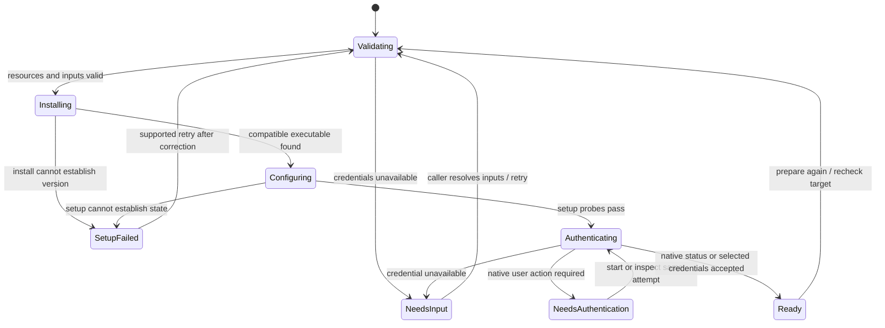

Preparation binds a complete request to one host scope. It checks resources and credential availability before installing or configuring software. Resuming rechecks actual target state; a saved phase cannot prove that software or credentials remain valid.

## Missing credentials

The application resolves credential references. Receipts store progress and identifiers, not resolved secret values or native command output. Authentication and billing choices are explicit; subscription authentication never silently falls back to API billing. Transient secret input can still be echoed or printed by the child.

## Authentication ownership

A nonblocking per-preparation lease rejects concurrent controllers promptly. Different IDs remain independent; every controller must share the coordinated store. Login attempts use a stable request, host scope, and attempt counter. Save failure retries the same launch. Only confirmed exit permits a new attempt. Lost ownership requires reconciliation; cancellation failure retains the old attempt.

Native login process exit does not prove authentication succeeded. The native status check owns that decision. A terminal login can be resumed with bounded output, transient input, resize, and cancellation through the exact process reference.

## Fresh launch plan

Only a current successful preparation returns a launch capability. Reusing a saved receipt cannot manufacture one. Software, setup probes, native login state, and freshly resolved credentials are checked again on resume. Real agent sign-in and inference remain separate acceptance work; synthetic process fixtures do not establish those outcomes.
