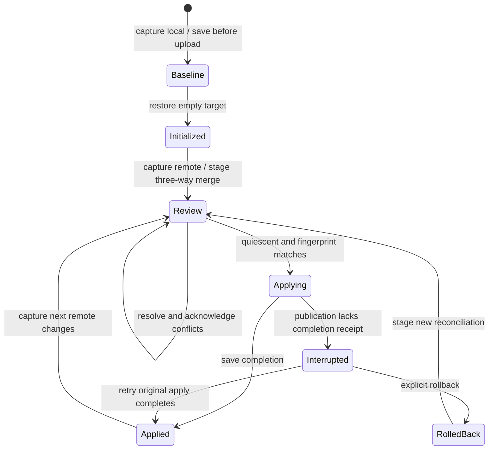
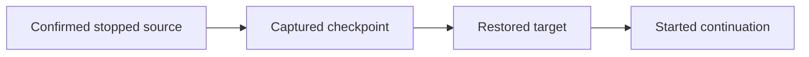

File sync moves selected project files, excluding private runtime state and mandatory secret paths. The caller must stop every writer and explicitly assert quiescence. This assertion does not lock arbitrary editors. Keep checkpoint storage and workflow receipts outside synchronized roots.

## Review before publication

Staging leaves the local project unchanged and preserves conflicting versions. Apply requires the latest review, conflict acknowledgement, explicit quiescence, and the expected local fingerprint. Stale local edits require a new review. Transfers validate cursors, declared length, size bounds, and checksum before importing a snapshot.

## Interrupted publication

A durable recovery journal can exist before any or all files change. Inspection reports interruption instead of inferring success from current files. Retry the original apply or explicitly roll back using its recovery identity. Finish that recovery before a new sync. An async caller disappearing must not release the publication lease while blocking publication still runs.

## Durable completion

Repeated completed apply returns its historical receipt without overwriting later edits. If publication succeeded but the workflow save failed, the next apply or sync recovers the baseline from the engine's durable result before processing newer remote changes. An apply receipt describes past publication, not today's files.

## Handoff to another target

Handoff first verifies that the source run is confirmed stopped, then records capture, restoration, and destination launch phases. The destination must be empty or an identical interrupted restoration. Repeating the same operation uses the same destination run ID, preventing duplicate continuation. Changed continuation intent conflicts. No VM memory or automatic conversation conversion is transferred.

## Caller cancellation and cleanup

After admission, an owned worker retains coordination and finishes the accepted operation through scoped archive cleanup and receipt publication, even if its caller stops awaiting. Canceling an observer is not a request to stop sync or handoff. Keep every writer quiescent until completion. A queued observer canceled before admission starts no operation.

Initialization, sync-back, and handoff retain workflow progress. Direct capture and restoration have no pollable workflow receipt; retain and await an application-owned task instead of canceling its observer. The same service and its clones admit one workflow or direct transfer at a time. Separate services still need caller coordination for direct transfers.

Runtime shutdown, process death, and cleanup transport failure can still leave a scoped archive. Removal remains best effort; it is not permission to delete unrelated files.

## Uncaptured destination data

Apply preflights result paths before recovery intent or mutation. Unselected files, symlinks and empty directories are preserved by refusing collisions. A selected directory cannot be replaced if uncaptured children remain. This prevents failed publication and automatic rollback from deleting data absent from the captured backup. Checks are bounded and still depend on actual caller-established quiescence. [Managed local sessions](managed-editing.md) compose this same owner with staged candidates and cooperative SDK leases.

The source checkpoint above covers the existing sync flow plus this preflight hardening. Execution, review closure and render validation are in the [managed-edit review](../reviews/2026-10-23-managed-editing.md).
