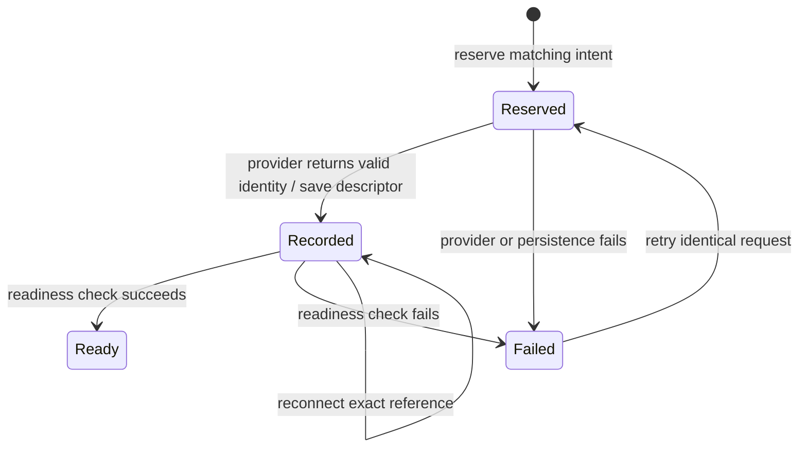

A workspace ID names one creation intent and target. Repeating the same request reconnects to its saved reference. Changing the provider or request under that ID is refused. A ready handle does not transfer ownership of an attached machine to the SDK.

## Creation intent

The repository records the complete request fingerprint before provider creation. This prevents a later caller from reusing the ID for different intent. Reservation is not a completed creation receipt or a universal provider lock. Providers must make creation retries safe under their own target identity.

## Reconnect evidence

The descriptor is saved before the readiness check. A timeout can therefore leave a reconnectable target. Reconnect rejects changed identity and unknown reference versions. File persistence uses an atomic replacement under a file lock and rejects invalid state instead of silently starting over.

## Failure and retry

A failed provider call or failed descriptor save can leave external effects without a saved descriptor. Retry uses the same reserved intent; callers must reconcile provider evidence when the result is uncertain. The SDK does not promise rollback of every provider failure.

## Ownership and deletion

Attached local directories remain caller owned. Owned target deletion is separate from handle lifetime. Dropping a workspace does not destroy it. Deletion observations distinguish pending, blocked, failed, and completed outcomes; a missing lookup alone does not prove cleanup finished. Inspect [provider behavior](../architecture.md) and [execution uncertainty](execution.md) before retrying lifecycle operations.
